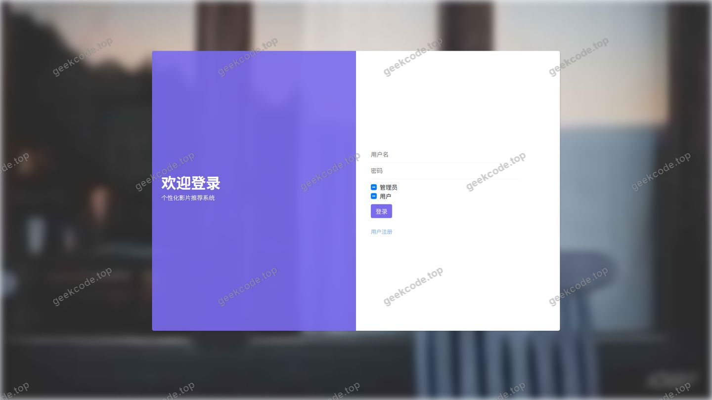
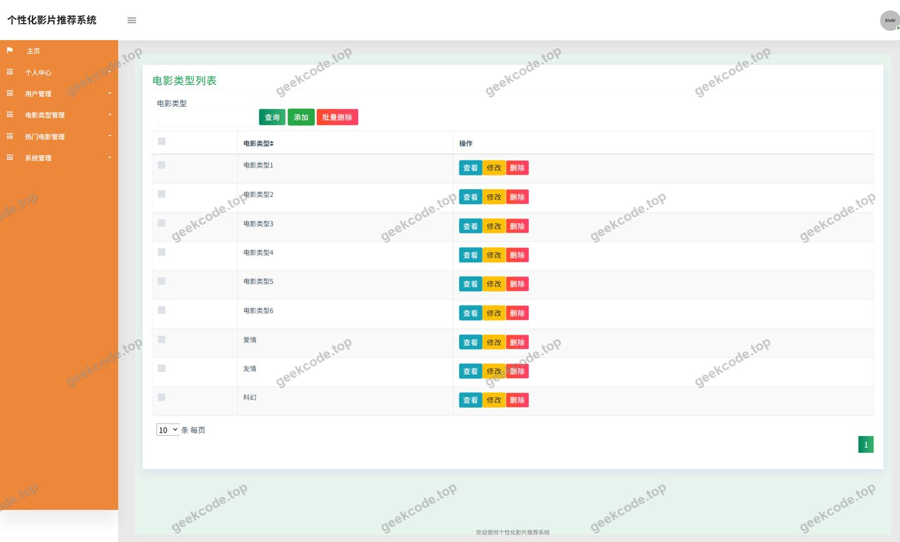
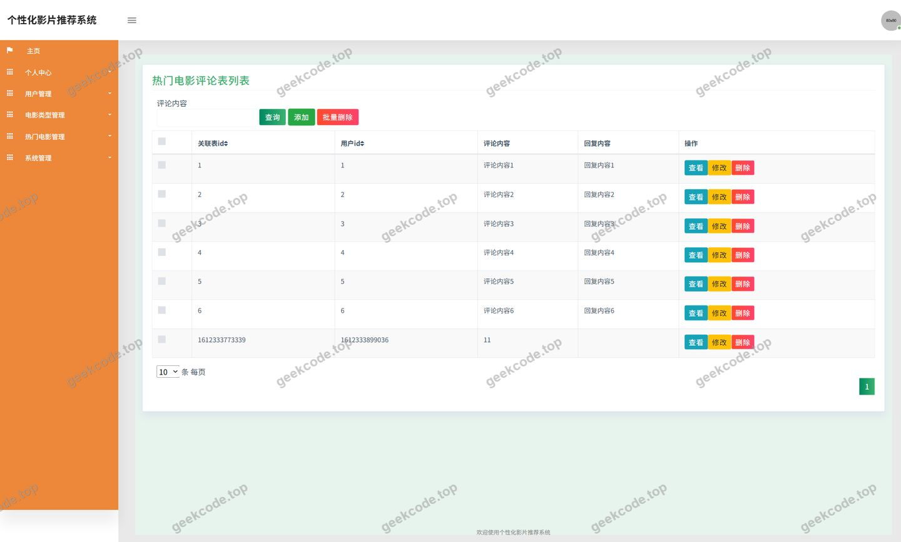
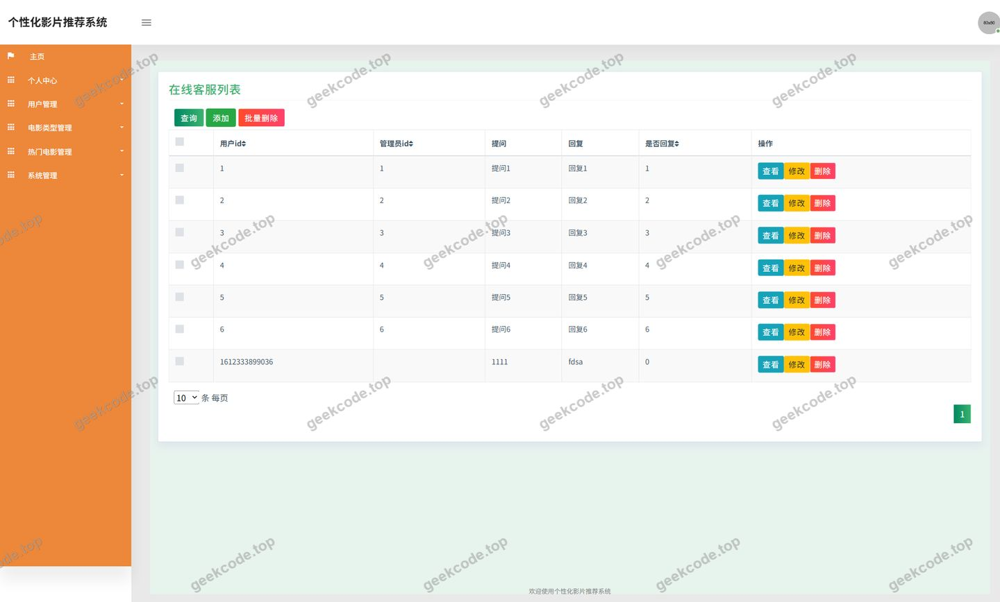
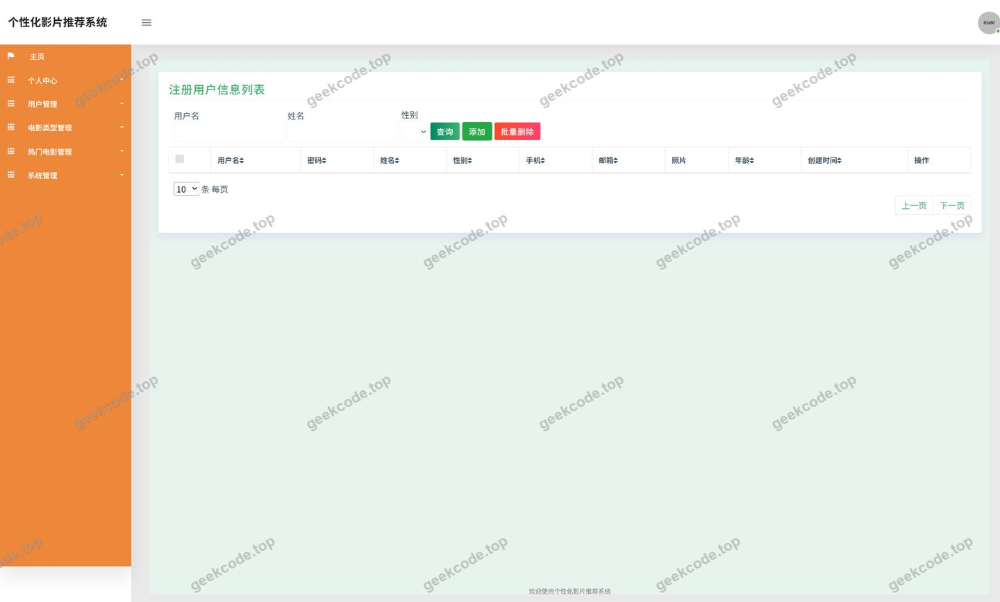
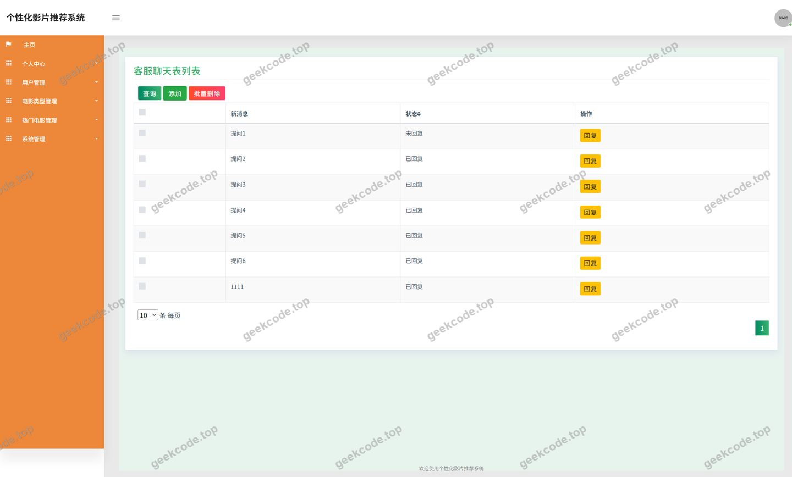
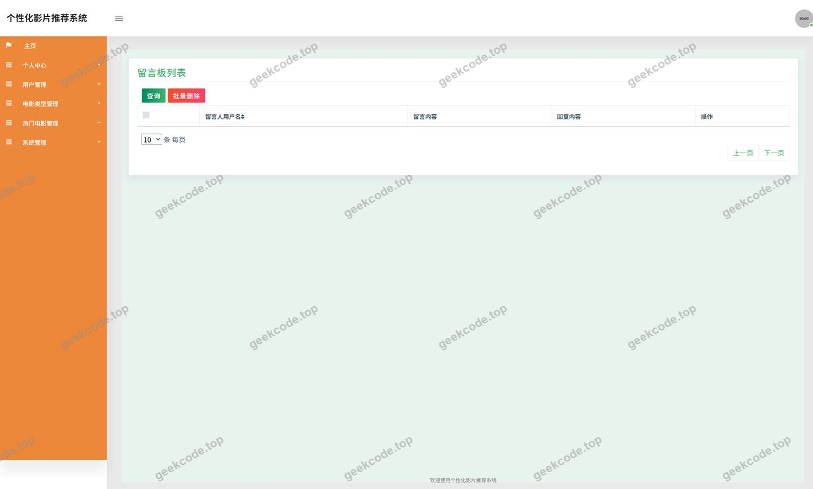
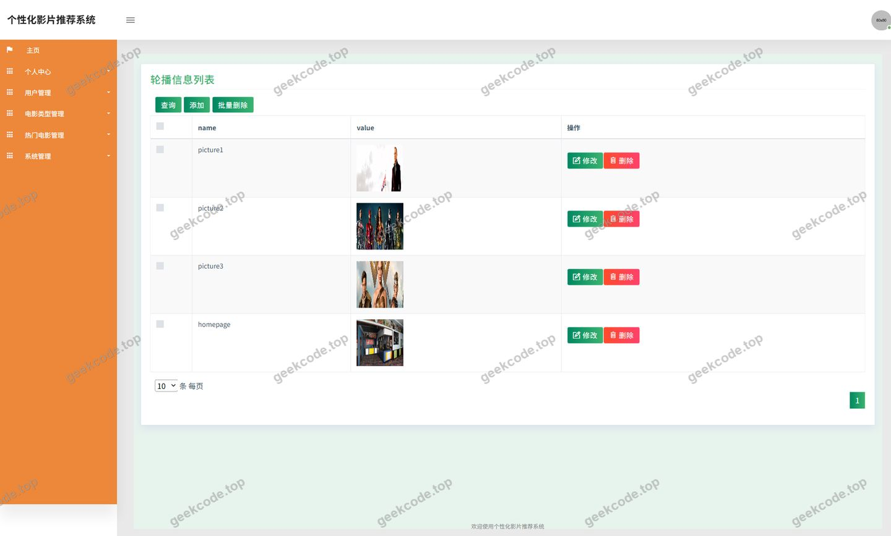
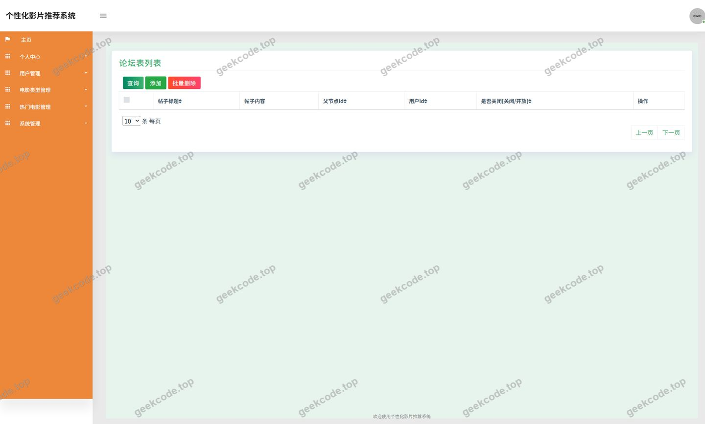

# java项目ssm个性化影片推荐系统计算机毕业设计

> 🎓 **计算机毕业设计 · java项目ssm个性化影片推荐系统计算机毕业设计**
>
> 本仓库只放**项目介绍 + 运行截图**（截图是站点带水印的原图，存在仓库 `images/` 里）。
>
> 👉 **完整可运行源码 / 数据库脚本 / 部署文档：[点我获取](https://geekcode.top/archives/java%E9%A1%B9%E7%9B%AEssm%E4%B8%AA%E6%80%A7%E5%8C%96%E5%BD%B1%E7%89%87%E6%8E%A8%E8%8D%90%E7%B3%BB%E7%BB%9F%E8%AE%A1%E7%AE%97%E6%9C%BA%E6%AF%95%E4%B8%9A%E8%AE%BE%E8%AE%A1?utm_source=github)**
>
> 💬 咨询微信：**ir9372**　|　🌐 更多项目：[极客代码 geekcode.top](https://geekcode.top/?utm_source=github)
>
> 📌 项目详情页：<https://geekcode.top/archives/java%E9%A1%B9%E7%9B%AEssm%E4%B8%AA%E6%80%A7%E5%8C%96%E5%BD%B1%E7%89%87%E6%8E%A8%E8%8D%90%E7%B3%BB%E7%BB%9F%E8%AE%A1%E7%AE%97%E6%9C%BA%E6%AF%95%E4%B8%9A%E8%AE%BE%E8%AE%A1?utm_source=github>

<table><td width="230" align="center"> <b>扫码加微信 ir9372</b></td><td valign="middle">📦 源码 = 项目介绍 + 全部运行截图 + 数据库 + 部署文档 👉 点上方任意截图，直接跳到 <b>极客代码 geekcode.top</b> 详情页</td></table>

---

<h1>java项目_ssm个性化影片推荐系统_计算机毕业设计</h1>
<h2>项目概述</h2>

本项目名为“java项目_ssm个性化影片推荐系统_计算机毕业设计”，是一个基于 SSM 架构的纯 API 后端项目。项目采用 Spring、Spring MVC、MyBatis-Plus 和 Druid 等技术，提供热门电影、新闻资讯、电影类型、用户管理、评论、收藏、客服、留言板、轮播图、论坛等业务接口。系统面向影片推荐场景，用户可通过接口获取热门电影和新闻资讯，管理个人收藏；管理员可通过接口管理用户、影片类型、热门电影、评论、新闻、客服信息、留言板、轮播图和论坛等内容。项目适用于计算机毕业设计，展示后端 API 开发能力，不包含独立的前台或后台页面。

<h2>技术架构</h2>

前后端架构：项目为 pure-api 类型，不包含前端页面，仅提供 HTTP 接口。前端或其他客户端可通过接口获取数据。后端基于 Spring 和 Spring MVC 构建，使用 MyBatis-Plus 作为持久层框架，Druid 作为数据库连接池。技术依赖包括 spring-core、spring-context、spring-context-support、spring-tx、spring-aop、spring-beans、spring-jdbc、spring-web、spring-webmvc、junit 等，属于传统 SSM 架构。

数据库设计要点：根据 Controller 列表，系统涉及用户、电影类型、热门电影、热门电影评论、新闻资讯、收藏、客服、留言板、轮播图、论坛等业务实体。数据库设计围绕这些实体展开，具体表结构需参考源码中的实体类与 MyBatis-Plus 映射。Druid 负责连接池管理与监控。

核心技术选型理由：Spring 提供 IoC 和 AOP 支持，便于管理对象和事务；Spring MVC 处理 Web 请求与响应；MyBatis-Plus 在 MyBatis 基础上提供通用 CRUD 操作，减少重复代码；Druid 提供高效的数据库连接池和监控功能，适合中小型项目。

<h2>功能模块</h2>
<h3>前台用户端</h3>
<ul>
<li>热门电影：提供热门电影列表、详情等接口，对应 RemendianyingController。</li>
<li>新闻资讯：提供新闻资讯浏览接口，对应 NewsController。</li>
<li>个人中心：提供用户个人信息管理接口，对应 UserController 或 YonghuController。</li>
<li>我的收藏：提供收藏的添加、删除、查询等接口，对应 StoreupController。</li>
<li>热门电影评论：提供对热门电影的评论发布、查询等接口，对应 DiscussremendianyingController。</li>
<li>客服聊天：提供客服聊天相关接口，对应 ChatController。</li>
<li>留言板：提供留言发布、查询等接口。</li>
<li>文件上传与下载：提供文件操作接口，对应 FileController。</li>
<li>通用功能：提供公共接口，对应 CommonController。</li>
<li>系统配置：提供配置读取接口，对应 ConfigController。</li>
<li>登录：提供用户登录接口，对应截图功能列表中的“页面-登录”。</li>
</ul>
<h3>后台管理端</h3>
<ul>
<li>用户管理：管理用户信息，对应 UserController、YonghuController 及截图功能列表中的“页面-用户”、“页面-defaultuser”。</li>
<li>电影类型管理：管理电影类型，对应 DianyingleixingController 及截图功能列表中的“页面-电影类型”。</li>
<li>热门电影管理：管理热门电影信息，对应 RemendianyingController。</li>
<li>热门电影评论管理：管理评论，对应 DiscussremendianyingController 及截图功能列表中的“页面-热门电影评论”。</li>
<li>新闻资讯管理：管理新闻资讯，对应 NewsController。</li>
<li>客服管理：管理客服信息，对应截图功能列表中的 kefuguanli。</li>
<li>留言板管理：管理留言板内容，对应截图功能列表中的 liuyanbanguanli。</li>
<li>轮播图管理：管理轮播图，对应截图功能列表中的 lunbotuguanli。</li>
<li>论坛管理：管理论坛帖子，对应截图功能列表中的 luntanguanli。</li>
<li>文件管理：管理上传文件，对应 FileController。</li>
<li>系统配置：管理配置项，对应 ConfigController。</li>
</ul>
<h2>用户角色与权限</h2>

系统包含两类角色：管理员和普通用户。

<ul>
<li>普通用户：可访问热门电影、新闻资讯、个人中心、我的收藏、热门电影评论、客服聊天、留言板、文件上传与下载、通用功能、系统配置、登录等前台用户端模块。根据现有信息，普通用户无法访问用户管理、电影类型管理、热门电影管理、热门电影评论管理、新闻资讯管理、客服管理、留言板管理、轮播图管理、论坛管理、文件管理、系统配置等后台管理端模块。</li>
<li>管理员：可访问所有模块，包括普通用户可访问的功能，以及用户管理、电影类型管理、热门电影管理、热门电影评论管理、新闻资讯管理、客服管理、留言板管理、轮播图管理、论坛管理、文件管理、系统配置等后台管理功能。</li>
</ul>
<h2>项目特色与创新点</h2>
<ul>
<li>采用 MyBatis-Plus 简化数据访问层开发，提升 CRUD 效率。</li>
<li>使用 Druid 连接池，提供数据库监控和性能统计能力。</li>
<li>项目为纯 API 设计，便于前后端分离，前端可灵活选用技术栈。</li>
<li>围绕影片推荐场景，整合热门电影、电影类型、用户收藏等模块，为用户提供影片信息与收藏服务。</li>
<li>提供完整的用户管理、内容管理、评论管理、客服、留言板、轮播图、论坛等后端接口，功能覆盖较广。</li>
</ul>
<h2>部署环境</h2>
<ul>
<li>JDK：1.8 或以上版本。</li>
<li>构建工具：Maven。</li>
<li>数据库：MySQL 5.7 或 8.0。</li>
<li>Web 服务器：Tomcat 8 或 9（因使用 Spring MVC，需 Servlet 容器）。</li>
<li>连接池：Druid。</li>
<li>依赖管理：通过 Maven 管理 junit、spring-core、spring-context、spring-context-support、spring-tx、spring-aop、spring-beans、spring-jdbc、spring-web、spring-webmvc 等依赖。</li>
<li>其他：根据现有信息，未提及 Node.js、微信开发者工具等，无需安装。</li>
</ul>
<h2>五、技术特性</h2>
<ul>
<li>使用 MyBatis-Plus 简化数据访问层开发</li>
</ul>
<h2>六、功能模块截图</h2>
<h3>后台管理端</h3>
<h4>页面-登录</h4>

<h4>页面-电影类型</h4>

<h4>页面-热门电影评论</h4>

<h4>页面-用户</h4>

<h4>页面-defaultuser</h4>

<h4>页面-kefuguanli</h4>

<h4>页面-liuyanbanguanli</h4>

<h4>页面-lunbotuguanli</h4>

<h4>页面-luntanguanli</h4>

---

## 获取完整源码

| 项目 | 说明 |
| --- | --- |
| 项目名 | java项目ssm个性化影片推荐系统计算机毕业设计 |
| 运行截图 | 本文 9 张（站点带水印原图，仓库 `images/` 目录） |
| 完整源码 | [https://geekcode.top/archives/java%E9%A1%B9%E7%9B%AEssm%E4%B8%AA%E6%80%A7%E5%8C%96%E5%BD%B1%E7%89%87%E6%8E%A8%E8%8D%90%E7%B3%BB%E7%BB%9F%E8%AE%A1%E7%AE%97%E6%9C%BA%E6%AF%95%E4%B8%9A%E8%AE%BE%E8%AE%A1?utm_source=github](https://geekcode.top/archives/java%E9%A1%B9%E7%9B%AEssm%E4%B8%AA%E6%80%A7%E5%8C%96%E5%BD%B1%E7%89%87%E6%8E%A8%E8%8D%90%E7%B3%BB%E7%BB%9F%E8%AE%A1%E7%AE%97%E6%9C%BA%E6%AF%95%E4%B8%9A%E8%AE%BE%E8%AE%A1?utm_source=github) |
| 咨询微信 | **ir9372**（备注：jingpin-yuanma） |
| 更多项目 | [极客代码 geekcode.top](https://geekcode.top/?utm_source=github) |

> 需要源码、部署、改配置、跑不起来等问题，加微信 ir9372 沟通，说明项目名即可。
